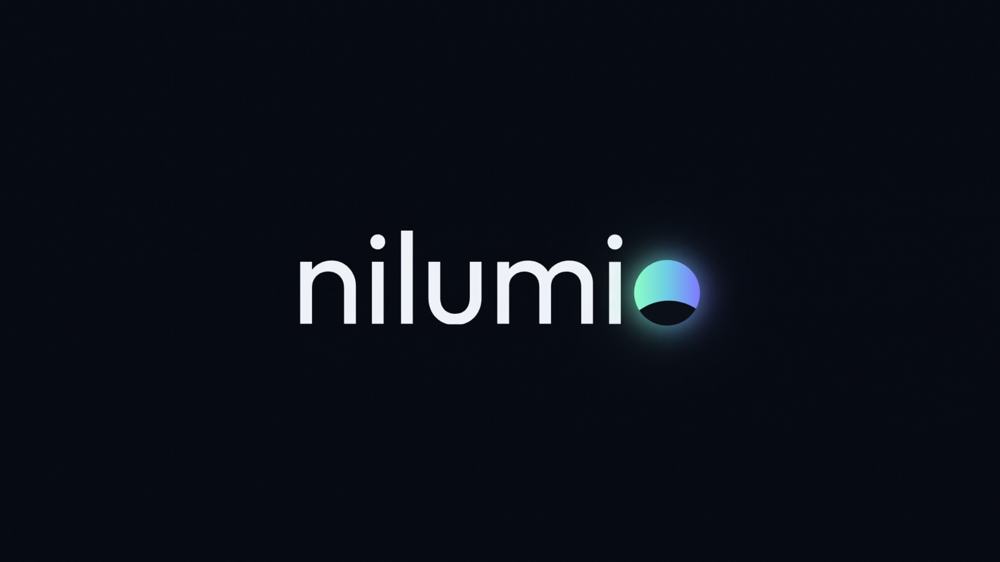
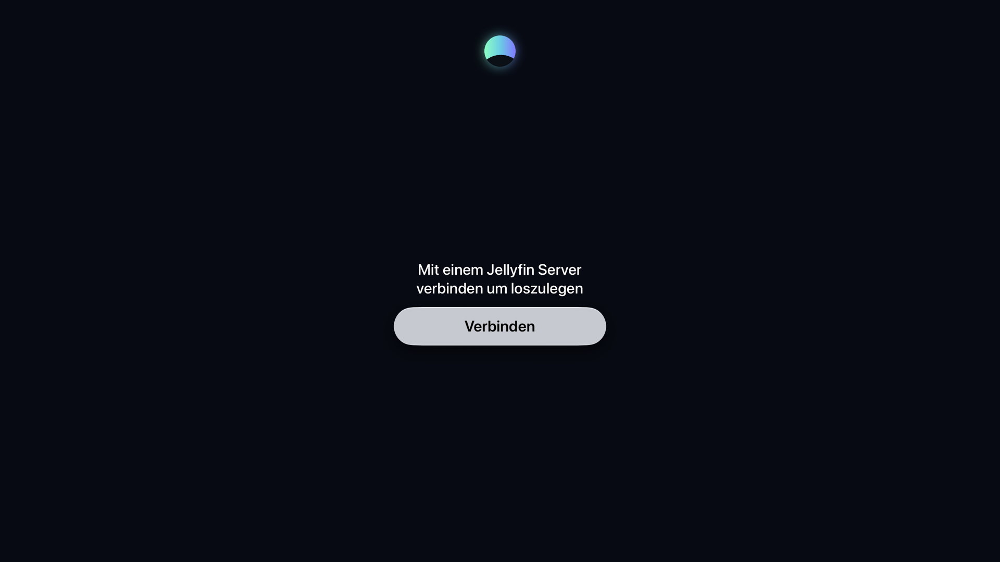
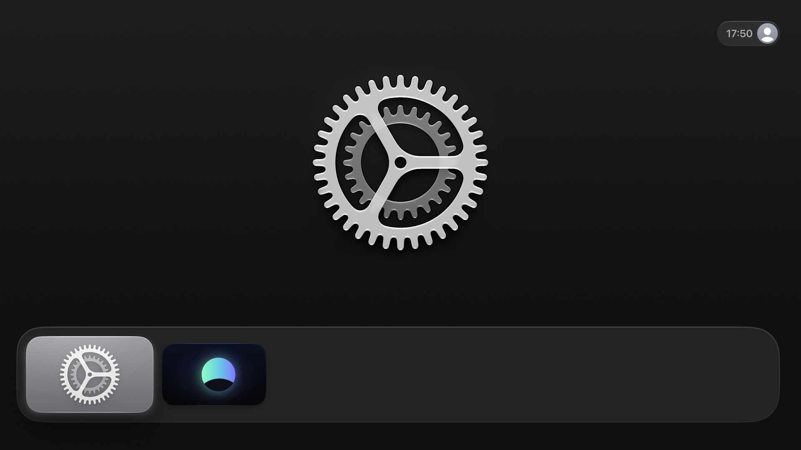

<!-- nilumio: start of fork section. Everything below the end marker is the original Swiftfin README. -->
# nilumio for Apple TV

> **Kurz auf Deutsch:** nilumio ist eine Apple-TV-App für deinen eigenen Jellyfin-Server. Sie ist ein Fork von Swiftfin und steht wie Swiftfin unter der Mozilla Public License 2.0. Neu sind eigenes Design, Start-Intro, britisches Englisch und gemeinsames Schauen (SyncPlay). Alle Änderungen gegenüber Swiftfin stehen in [NILUMIO_CHANGES.md](NILUMIO_CHANGES.md). Kontakt: webmaster@nilumio.com

**nilumio** is an Apple TV app for your own [Jellyfin](https://jellyfin.org) media server. It is a fork of [Swiftfin](https://github.com/jellyfin/Swiftfin), the Jellyfin community's native client, and keeps Swiftfin's interface and its VLC and native players.

What nilumio adds on top of Swiftfin:

- its own name, app icon, top shelf images and colours, and a short start-up intro
- *SyncPlay*: synchronised playback with Jellyfin SyncPlay groups, also together with Jellyfin Web or Android
- British English texts (colour, favourite, licence)

nilumio is not an official Jellyfin product and does not use the Jellyfin or Swiftfin logos. Website: [nilumio.com](https://nilumio.com)

## Screenshots

| Intro | Start | Home |
|---|---|---|
|  |  |  |

<!-- More screenshots to follow. Use only freely licensed media (for example the Blender open movies). -->

## Origin and licence

- Based on Swiftfin `main` at commit [`04e0aa1`](https://github.com/jellyfin/Swiftfin/commit/04e0aa10812385be55831cbf925dbee925056976) (21 October 2026, after release 1.6.1). The upstream repository is configured as the `upstream` remote.
- Licence: [Mozilla Public License 2.0](LICENSE.md), like Swiftfin. Swiftfin's licence headers stay in place. Origin and licence are summarised in [NOTICE.md](NOTICE.md); every added or changed file, with dates, is listed in [NILUMIO_CHANGES.md](NILUMIO_CHANGES.md).
- Libraries and other third-party material: [THIRD_PARTY_NOTICES.md](THIRD_PARTY_NOTICES.md).
- An overview of how much of this repository is nilumio's own work: [docs/OWN_CODE.md](docs/OWN_CODE.md).

## Building

Requirements: Xcode 26.6 or newer (tested with Xcode 27.1 and the tvOS 27 simulator).

```sh
xcodebuild -project Swiftfin.xcodeproj -scheme "Swiftfin tvOS" -configuration Debug \
  -destination 'platform=tvOS Simulator,name=Apple TV 4K (3rd generation)' \
  -skipMacroValidation -skipPackagePluginValidation CODE_SIGNING_ALLOWED=NO build
```

On a real Apple TV: open the scheme "Swiftfin tvOS" in Xcode, choose your own team under
Signing & Capabilities (or create `XcodeConfig/DevelopmentTeam.xcconfig` with
`DEVELOPMENT_TEAM = …`; the file is ignored by git) and select the paired Apple TV as the destination.

## SyncPlay (SyncPlay)

The menu entry *SyncPlay* creates or joins a SyncPlay group, also with Jellyfin Web,
Android and other clients. In a group, pause, play and seeking are sent to the server as
requests; the server's command is then carried out on every device at the same server time.
Whoever starts something in the group starts it for everyone. SyncPlay must be allowed for
the user on the server.

## Contributing

Small, focused pull requests are welcome. Please read [CONTRIBUTING.md](CONTRIBUTING.md)
first: bugs that also exist in Swiftfin should go to Swiftfin first. nilumio's own code lives in
`Shared/Nilumio/`, and changes to Swiftfin files are marked with `// nilumio`, so upstream
updates stay easy ([docs/UPSTREAM.md](docs/UPSTREAM.md)).

## Contact

- General questions and feedback: webmaster@nilumio.com
- Security issues: see [SECURITY.md](SECURITY.md)

---
<!-- nilumio: end of fork section. Original Swiftfin README follows. -->

<div align="center">
  

  <h1>Swiftfin</h1>
  
  
  
  
  <a href="https://translate.jellyfin.org/engage/swiftfin/">
    
  </a>
  <a href="https://matrix.to/#/#jellyfin:matrix.org">
    
  </a>
  <a href="https://discord.gg/zHBxVSXdBV">
    
  </a>
</div>

<p align="center">
  <b>Swiftfin</b> is a modern video client for the <a href="https://github.com/jellyfin/jellyfin">Jellyfin</a> media server. Made using Swift to maximize direct play with the power of <b>VLC</b> and look <b>native</b> on all classes of Apple devices.
</p>

## ⚡️ Download

<a href="https://apps.apple.com/us/app/swiftfin/id1604098728">
  
</a>

## 🛠️ TestFlight

Use the TestFlight version to test new features and bug fixes before being published to the App Store. We are grateful for your time and resources for reporting new bugs.

<a href="https://testflight.apple.com/join/SqNPfdxq">
  
</a>

## 📖 Documentation

Swiftfin provides detailed documentation to help you understand key aspects of the app and its development approach:

- [🎞️ Library Support](https://github.com/jellyfin/Swiftfin/blob/main/Documentation/libraries.md) — Information on **library compatibility** and supported media types in Swiftin.
- [🎬 Media Playback](https://github.com/jellyfin/Swiftfin/blob/main/Documentation/players.md) — Learn about Swiftfin's **Native** and **VLC** players and how their features vary.
- [🧩 OS Version Support](https://github.com/jellyfin/Swiftfin/blob/main/Documentation/version.md) — Read about how we determine the **minimum supported OS** and which versions of iOS & tvOS are supported.
- [🐞 Common Issues](https://github.com/jellyfin/Swiftfin/blob/main/Documentation/common_issues.md) — If you are experiencing an issue with Swiftfin, this is the best place to start.
- [💜 Supporting Development](https://jellyfin.org/docs/general/contributing/direct-donations) — Learn how you can **support the project developers** and help keep Swiftfin improving.

## ⚙️ Development

Thank you for your interest in Swiftfin! Please check out the [Contribution Guidelines](https://github.com/jellyfin/Swiftfin/blob/main/Documentation/contributing.md) to get started.

## 📚 Translations

**Don't see Swiftfin in your language?**

Check out our [Weblate instance](https://translate.jellyfin.org/projects/swiftfin/) to help translate Swiftfin and other Jellyfin projects.

<a href="https://translate.jellyfin.org/engage/swiftfin/">

</a>
